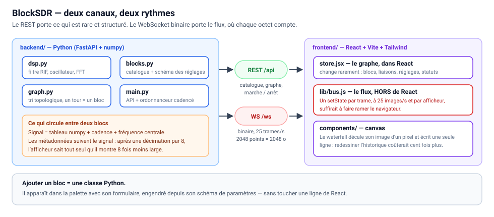

# BlockSDR

Un **récepteur SDR à graphe de blocs, dans le navigateur** — l'esprit de GNU Radio
Companion, mais en page web : on pose des blocs, on tire des fils, on règle les
paramètres, et le spectre défile.

Né d'une frustration : les WebSDR existants enferment l'utilisateur dans des
« profils » de bande figés. Ici **rien n'est figé** — la fréquence est un
paramètre comme un autre.

> 🔧 **État : prototype qui tourne.** Source **simulée** (aucun matériel requis),
> chaîne décimation → FFT → waterfall/spectre/oscilloscope, édition du graphe en
> direct. **Pas d'audio pour l'instant**, c'est assumé : voir la feuille de route.

---

## Démarrer

```bash
docker compose up --build      # puis http://localhost:5180
```

Le front (Vite) relaie `/api` et `/ws` vers le backend Python : une seule origine
côté navigateur, donc **aucun souci de CORS ni de WebSocket**.

Sans Docker, en deux terminaux :

```bash
cd backend  && pip install -r requirements.txt && uvicorn app.main:app --reload
cd frontend && npm install && npm run dev
```

Au premier lancement, un graphe d'exemple est déjà en place. **Appuie sur
Démarrer** : trois « stations » simulées apparaissent sur le waterfall.

## Production

Le déploiement suit **exactement** le schéma de surfcast, pour ne pas inventer
une deuxième façon de faire :

```
push sur master ──► GitHub Actions ──► ghcr.io/calaxo/blocksdr:latest
                                              │
                          Komodo (stack « blocksdr », serveur local)
                          tire l'image + le docker-compose.yml de HomeCalLab
                                              │
                                    Traefik local ──► https://blocksdr.example.org
```

| Pièce | Où | Détail |
|---|---|---|
| Image | `.github/workflows/docker-publish.yml` | Un seul conteneur : front buildé + backend. Tags `latest` et sha court. Le `GITHUB_TOKEN` du dépôt suffit pour publier sur ghcr |
| Déploiement | `HomeCalLab/stacks/blocksdr/docker-compose.yml` | Le dépôt applicatif est séparé du dépôt de déploiement |
| Identifiants | Komodo | `registry_provider = ghcr.io`, `registry_account = calaxo` — le paquet ghcr est **privé**, sans ça le `pull` renvoie « denied » |

**Mettre à jour la production** : pousser sur `master`, attendre la CI, puis
*Deploy* sur la stack Komodo (`auto_pull` est actif, l'image est retirée à
chaque déploiement). Pas de redéploiement automatique sur push — c'est la
convention du homelab.

⚠️ **Un dongle = un programme.** En production, blocksdr tourne sur sa **source
simulée** : il ne touche pas au RTL-SDR et cohabite donc avec le stack
`openwebrx`, qui lui tient le dongle en permanence. Pour lui donner le vrai
signal, il faudra **arrêter openwebrx** d'abord.

## Ce qu'on voit à l'écran

| Zone | Rôle |
|---|---|
| **Barre du haut** | Démarrer/Arrêter, état du flux, **tours/s** et **charge** — les deux chiffres qui disent si le graphe tient la cadence |
| **Colonne de gauche** | Le catalogue de blocs, **construit à partir de ce que le backend déclare** |
| **Centre** | Le graphe. Sortie orange → entrée bleue. `Suppr.` efface la sélection |
| **Bas** | Un panneau par afficheur présent dans le graphe |
| **Colonne de droite** | Les réglages du bloc sélectionné, **formulaire engendré** depuis le schéma Python |

## Architecture



**Deux canaux, volontairement séparés.** Le REST porte ce qui est rare et
structuré (catalogue, graphe, marche/arrêt). Le WebSocket **binaire** porte le
flux, où chaque octet compte :

```
[uint32 LE : longueur en-tête][en-tête JSON][charge utile]
```

Un spectre de 2048 points tient en **2048 octets** (un octet par point, quantifié
entre le plancher et le plafond en dB). En JSON, la même trame coûterait dix fois
plus — pour une donnée qu'on jette 25 fois par seconde.

**Aucune trame ne passe par l'état React.** Les afficheurs s'abonnent au bus et
dessinent eux-mêmes dans leur canvas ; React ne gère que ce qui change rarement.
Un `setState` par trame, à 25 images/s et par afficheur, suffirait à faire ramer
le navigateur.

## Les blocs

| Bloc | Rôle |
|---|---|
| **Source simulée** | Fabrique un flux I/Q synthétique. 5 scènes : bande FM, deux porteuses, balayage, salves, bruit |
| **RTL-SDR** | Le vrai dongle (`pyrtlsdr`). Signale proprement son absence au lieu de faire semblant |
| **Décalage de fréquence** | Fait glisser le spectre pour amener une station au centre |
| **Décimation** | Filtre puis jette des échantillons — voir ci-dessous |
| **FFT** | Du temps vers la fréquence. Fenêtrage + moyennage de Welch |
| **Spectre / Waterfall / Oscilloscope / Puissance** | Les afficheurs |

Ajouter un bloc = **une classe Python**. Il apparaît dans la palette, avec son
formulaire, sans toucher une ligne de React.

## La décimation, puisque c'est la question qui revient

Le dongle sort **2 400 000 échantillons par seconde**. Une station FM n'occupe
que **200 kHz**. Traiter les 2,4 MHz entiers pour n'en écouter qu'un douzième,
c'est payer douze fois trop cher — en calcul, en mémoire, en réseau.

La décimation, c'est **garder 1 échantillon sur N**. 2 400 000 ÷ 12 = 200 000 :
exactement ce qu'il faut.

⚠️ **Mais on ne peut pas simplement en jeter.** Tout ce qui dépasse la nouvelle
largeur de bande ne disparaît pas : ça **se replie** à l'intérieur, et apparaît
comme des stations qui n'existent pas — le même phénomène qui fait tourner les
roues de chariot à l'envers au cinéma. D'où l'ordre obligatoire :

1. **filtrer** (passe-bas, pour ne garder que la bande qu'on veut conserver),
2. **puis jeter** les échantillons excédentaires.

C'est pour ça que le bloc `decimate` contient un filtre qui n'est pas optionnel,
et que son paramètre « coupure » est exprimé en fraction de la **nouvelle**
cadence : au-delà de 0,5, le repliement est mathématiquement garanti.

Le prix à payer est visible dans l'interface : décime par 8 et le waterfall
devient 8 fois plus étroit — on a échangé de la largeur de bande contre du calcul.

## Choix techniques, et pourquoi

- **numpy sans scipy.** Filtre RIF, oscillateur local et FFT fenêtrée tiennent en
  quelques dizaines de lignes ; ça évite une dépendance lourde dans l'image.
- **Blocs à état.** En flux continu, un filtre doit mémoriser la queue du bloc
  précédent et un oscillateur sa phase — sinon on entend un « clic » à chaque
  frontière de bloc. C'est *la* différence avec le traitement d'un fichier entier.
- **Ordonnanceur simplifié.** Tri topologique, puis un tour = un morceau de flux
  pour chaque bloc. Pas de files d'attente par arête comme GNU Radio : suffisant
  tant qu'on reste sur des chaînes linéaires, et cent fois plus simple à lire.
- **Cadence imposée par la source.** Sans ça, la source simulée tournerait à la
  vitesse du processeur et produirait des heures de signal par seconde. C'est le
  rôle du bloc *Throttle* de GNU Radio ; ici l'ordonnanceur s'en charge tout seul.
- **Toute modification du graphe le reconstruit** côté serveur (avec 400 ms de
  regroupement). Simple, prévisible — et c'est aussi ce que fait GNU Radio
  Companion quand on relance un flowgraph.

## Feuille de route

- [x] Moteur de graphe, catalogue, édition en direct, afficheurs
- [x] Source simulée — développer sans matériel
- [ ] **Brancher le vrai RTL-SDR** : décommenter `pyrtlsdr` et le passage USB
      dans `docker-compose.yml`, échanger le bloc source. Le reste ne bouge pas
- [ ] Sauvegarde / chargement de graphes (`.json`), et quelques exemples fournis
- [ ] Clic sur le waterfall pour poser le décalage de fréquence
- [ ] **Audio** : démodulation WFM/NFM/AM. ⚠️ Le vrai morceau n'est pas la
      démodulation (quelques lignes) mais la **dérive d'horloge** entre le quartz
      du dongle et celui de la carte son. Contraintes, arithmétique des cadences
      et plan de construction : **[`docs/audio.md`](docs/audio.md)**
- [ ] Décodeurs (ADS-B, capteurs 433/868) en blocs

Étude de faisabilité et comparaison avec l'existant :
`labo-electronique/websdr-maison/README.md`.
