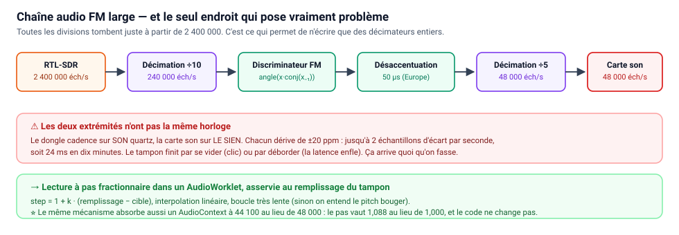

# Faire de l'audio — contraintes et plan

> Note de conception, écrite **avant** d'écrire le code. L'audio est la partie
> qui fait échouer la plupart des projets de ce type, et presque jamais pour des
> raisons de radio.

---

## 1. L'arithmétique des cadences décide de tout

C'est le point à régler en premier, parce qu'il contraint le reste. Il faut
descendre de la cadence du dongle jusqu'à **48 000 échantillons/s** (celle de la
carte son). Si la division ne tombe pas juste, il faut un rééchantillonneur à
rapport fractionnaire — beaucoup plus de code.

| Cadence du dongle | Vers 48 kHz | Verdict |
|---|---|---|
| **2 400 000** | ÷ 50 exactement. Ou ÷ 10 → **240 000** (WFM) puis ÷ 5 → 48 000 | ✅ **La bonne.** Tout tombe juste |
| **2 048 000** *(notre défaut actuel)* | ÷ 42,67 ❌ | Ne divise **pas** vers 48 kHz. Elle divise vers **32 000** (÷ 64) |
| 1 024 000 | ÷ 21,33 ❌ | idem |

👉 **Décision : passer le défaut du bloc RTL-SDR à 2 400 000** le jour où on fait
l'audio. Ce n'est pas un détail de confort : c'est ce qui permet de n'écrire que
des décimateurs entiers, ceux qu'on a déjà.

⚠️ Deuxième piège, côté navigateur : `AudioContext.sampleRate` **n'est pas
toujours 48 000** (44 100 sur certaines machines). On demande explicitement
`new AudioContext({ sampleRate: 48000 })`, et on prévoit le cas où le navigateur
refuse — voir §3, le même mécanisme règle les deux problèmes d'un coup.

## 2. Les chaînes de démodulation



**FM large (radio commerciale)** — canal de 200 kHz :

```
2 400 000  ─décimation ÷10─►  240 000  ─discriminateur FM─►  désaccentuation 50 µs
           ─décimation ÷5──►   48 000  ─►  audio
```

Le discriminateur tient en une ligne : `np.angle(x[1:] * np.conj(x[:-1]))`. La
**désaccentuation 50 µs** (norme européenne ; 75 µs aux USA) est un simple filtre
passe-bas du premier ordre — sans elle, le son est criard et sifflant.

**FM étroite (PMR, relais, talkies)** — canal de 12,5 kHz :

```
2 400 000  ─décalage (NCO)─►  ─décimation grossière ÷50─►  48 000
           ─filtre de canal ±6 kHz─►  discriminateur  ─►  squelch  ─►  audio
```

⚠️ **Le filtre de canal n'est pas optionnel.** Notre bloc de décimation coupe à
0,45 × la nouvelle cadence, soit ±21,6 kHz : bien trop large pour de la NFM, on
entendrait les canaux voisins par-dessus. D'où la règle générale : **décimation
grossière d'abord** (rapide, large), **filtre étroit ensuite** (peu coûteux
puisque la cadence est déjà tombée).

**AM (aviation)** : module du signal complexe, puis suppression de la composante
continue (la porteuse), puis décimation. Deux lignes de calcul.

## 3. 🔴 Le vrai morceau : la dérive d'horloge

Le dongle cadence ses échantillons sur **son** quartz. La carte son consomme sur
**le sien**. Ils sont indépendants, et chacun dérive de ±20 ppm environ.

Concrètement : jusqu'à **40 ppm d'écart**, soit ~2 échantillons par seconde à
48 kHz. En dix minutes, ~1 150 échantillons, soit 24 ms. Le tampon audio finit
donc **par se vider** (clic, coupure) **ou par déborder** (la latence enfle sans
cesse). Ça arrive quoi qu'on fasse, et ça n'a rien à voir avec la radio.

Trois remèdes possibles :

| Stratégie | Coût | Qualité |
|---|---|---|
| Jeter / dupliquer un échantillon quand le tampon dérive | 10 lignes | Micro-clics audibles sur de la musique, inaudibles sur de la parole |
| Ajuster `playbackRate` du nœud audio | ~20 lignes | Bon, mais on subit l'interpolation du navigateur |
| ⭐ **Lecture à pas fractionnaire dans un AudioWorklet**, asservie au remplissage | ~30 lignes | Propre, et c'est ce que font les vrais WebSDR |

👉 **Décision : la troisième.** Le worklet lit son tampon circulaire à un pas
`step = 1 + k · (remplissage − cible)` avec interpolation linéaire, et une boucle
d'asservissement très lente (constante de temps de plusieurs secondes, sinon on
entend le pitch bouger).

⭐ **L'élégance de ce choix** : le même mécanisme absorbe **aussi** un
`AudioContext` à 44 100 au lieu de 48 000. Le pas devient 48000/44100 = 1,088 au
lieu de ~1,000 — le code est identique, il n'y a pas de cas particulier à écrire.

## 4. Transport

L'audio passe par **le WebSocket déjà en place** : notre en-tête binaire porte
déjà un champ `kind`, il suffit d'ajouter `kind: "audio"`. Aucune plomberie
nouvelle.

| Format | Débit | Quand |
|---|---|---|
| **PCM Int16, 48 kHz mono** | 768 kbit/s | ✅ Pour commencer. Sans souci en LAN, trivial à décoder |
| Opus 48 kbit/s | 48 kbit/s | Plus tard, pour écouter par Tailscale depuis l'extérieur. Demande un encodeur côté Python |

Taille de trame : **20 à 40 ms** (960 à 1920 échantillons). Plus gros = moins de
trames mais plus de latence.

## 5. Budget de latence, et ce qu'il impose au reste

| Étage | Latence |
|---|---|
| Bloc USB — 16 384 éch. à 2,4 MS/s | 6,8 ms |
| ⚠️ **mais** 16 384 éch. = 146 tours/s : trop de tours pour rien | → passer à **65 536** (27 ms, 36 tours/s) |
| Réseau + trame | ~10 ms |
| Tampon de gigue (3 à 5 trames) | 100 à 200 ms |
| **Total oreille** | **250 à 400 ms** |

Confortable pour écouter, désagréable quand on tourne le bouton de fréquence —
c'est le compromis habituel, et il est acceptable.

👉 **Conséquence sur l'existant** : la taille de bloc par défaut du bloc RTL-SDR
devra passer de 16 384 à 65 536 pour l'audio.

## 5 bis. Le budget processeur est là, et il n'était pas gagné

Mesuré sur la VM le 2026-08-24, dongle réel à 2,4 MS/s : **6 % d'un cœur** pour
l'acquisition + FFT + waterfall, 36 tours/s sur 36,6 théoriques.

Mais avant correction, la **source seule** en consommait **100 %** — la faute à
`read_samples()` de pyrtlsdr et à son complex128. Autrement dit : sans cette
correction, il n'y avait pas un seul pour-cent de disponible pour la
démodulation, et l'audio aurait été condamné avant d'être écrit. C'est le genre
de chose qu'on ne voit qu'en branchant le vrai matériel.

## 6. Les contraintes propres au RTL-SDR

| Contrainte | Effet sur l'audio | Remède |
|---|---|---|
| ⭐ **Pic de continu au centre** | Le RTL2832U a un décalage de continu : une raie parasite pile à la fréquence centrale. Accorder une station dessus = un ronflement permanent | **Ne jamais mettre la station au centre.** Décaler le dongle de 200-300 kHz et ramener la station avec le bloc « Décalage de fréquence ». Le bloc existe déjà |
| **Convertisseur 8 bits** | ~50 dB de dynamique seulement. Une station forte à côté écrase la faible | Régler le gain **à la main** plutôt qu'en auto, au plus petit qui fait sortir le signal |
| **Pas de quartz compensé** | Dérive de quelques kHz. Inaudible en FM large (canal de 200 kHz), **rédhibitoire en NFM et en AM** : la station est désaccordée | Correction **PPM**, à mesurer une fois sur une station de fréquence connue |
| **Échantillons perdus en rafale** | Si le lecteur est en retard, le pilote jette des échantillons **en silence** → craquements réguliers | ✅ Déjà traité : plus d'attente artificielle avec une source matérielle, et le tour de graphe tourne dans un exécuteur |
| **Un dongle = un programme** | Impossible d'écouter ici pendant qu'openwebrx tient le dongle | Arrêter l'autre, ou acheter un 2ᵉ dongle (~15 €) |

Et une contrainte qui ne vient pas de la radio : **les navigateurs bloquent le
son tant qu'il n'y a pas eu de geste de l'utilisateur.** L'`AudioContext` doit
être créé ou réveillé **dans le gestionnaire d'un clic** — sinon rien ne sort et
aucune erreur ne s'affiche.

## 7. Plan de construction

1. **Blocs de démodulation** : `fm_demod` (large et étroit), `am_demod`. Sortie :
   un `Signal` de type `audio` à 48 kHz. ~40 lignes chacun.
2. **Bloc `audio_sink`** : envoie des trames `kind: "audio"` en Int16 sur le
   WebSocket existant.
3. **Côté navigateur** : `AudioWorklet` + tampon circulaire + lecture à pas
   fractionnaire asservie. **C'est l'étape qui coûte**, prévoir plusieurs
   séances.
4. **Squelch** (indispensable en NFM, sinon souffle permanent), **désaccentuation**,
   **AGC**.
5. Plus tard : **stéréo FM** (pilote 19 kHz + sous-porteuse 38 kHz), **Opus**,
   **RDS** (le nom des stations).

Avant tout ça, deux changements de défauts déjà identifiés : **cadence à
2 400 000** et **taille de bloc à 65 536**.
